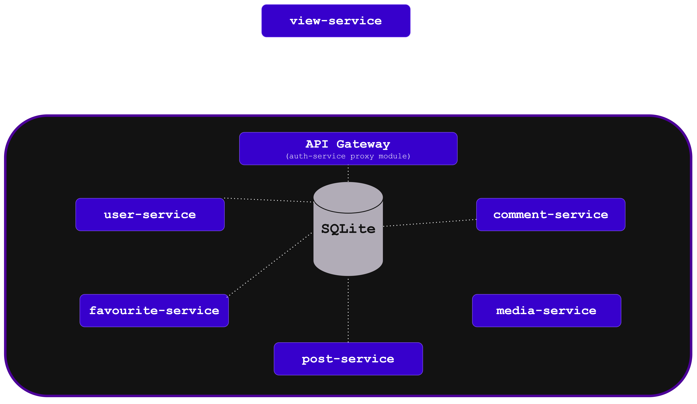
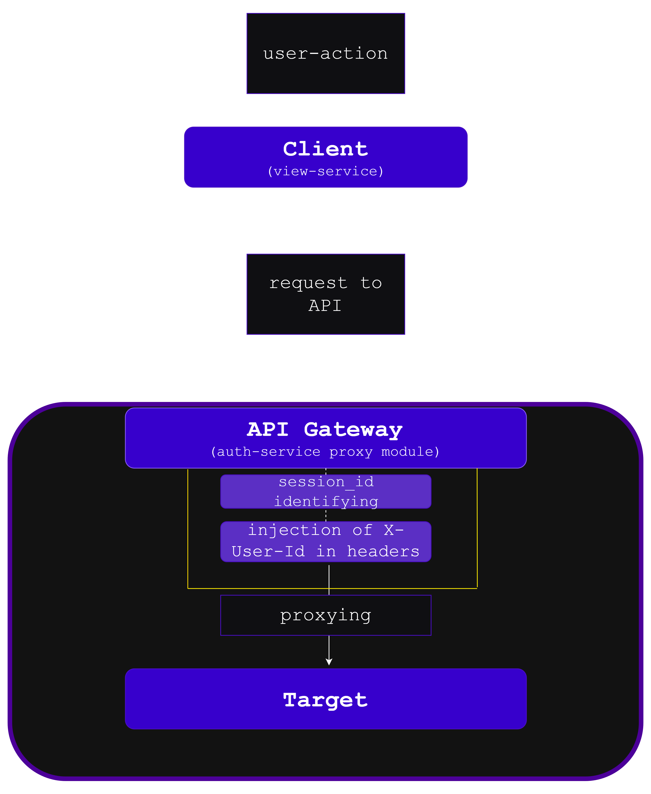

##### **For the KAIST Admissions Committee** 2026
Application ID:
## 1. Project Overview & Problem Statement

- **Project Name:** Jolly Mart.

- **Problem Statement:** Created for items exchange/selling. The website was developed as final project for 1-year industrial programming course (Yandex.Lyceum). It provides convenient digital platform for products exchanging. 

- **Target Audience:** Digital-native shoppers aged 18–35 looking for a convenient shopping experience, alongside local brands seeking an easy-to-use platform to list and manage their products.

- **Key Features:**
	**Feedback From Customers**: Enables customers to leave comments on sellers' items.
	**Favorites List**:  Allows customers to add items to customers' favorites.
	**Intuitive interface:**  Enables sellers to list their items seamlessly.

---
## 2. System Architecture & Tech Stack

- **High-Level Architecture Diagram:** 

- **Technology Stack & Trade-offs:**
    
    - **Frontend:** Flask + Jinja2 (straightforward documentation, lightweight framework)
    
    - **Backend:** Flask (chosen for its simplicity and lightweight, minimalist architecture). For the ORM, SQLAlchemy was selected as it is one of the most popular and widely-used ORMs for Python.
    
    - **Database:** SQLite.
     
    - **Infrastructure & DevOps:** A microservice architecture was chosen, utilizing Docker containers for isolation and orchestration. The microservice architecture enables independent parts of the program to communicate with each other via the robust communication protocol: HTTP, alongside with simplicity of project's expansion in the future.

---
## 3. Database & System Design

- **Data Flow Schema:** 

 

- **Security & Authentication:**  For authentication and authorization, an API Gateway pattern was selected. All incoming client requests are routed through a centralized entry point (`auth-service`), which identifies the user and then appends an `X-User-Id` header to the request before proxying it to its final destination. Otherwise, in case it cannot identify a user, it blocks the request.

---

## 4. Summary

This project has significantly enhanced my understanding of system scalability, the network programming, architectural design, and code documentation practices, providing me with a solid foundation for building production-grade web applications in the future.

